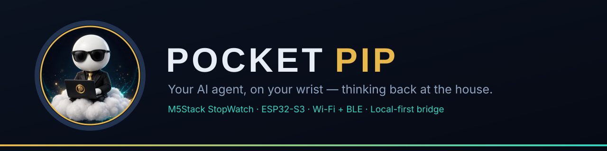
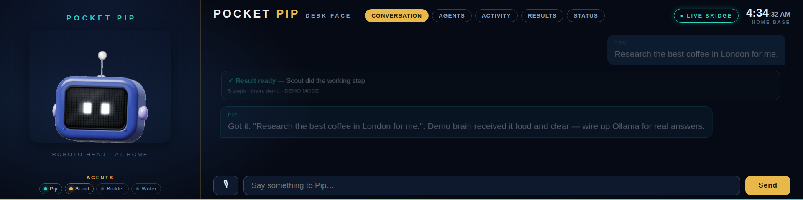
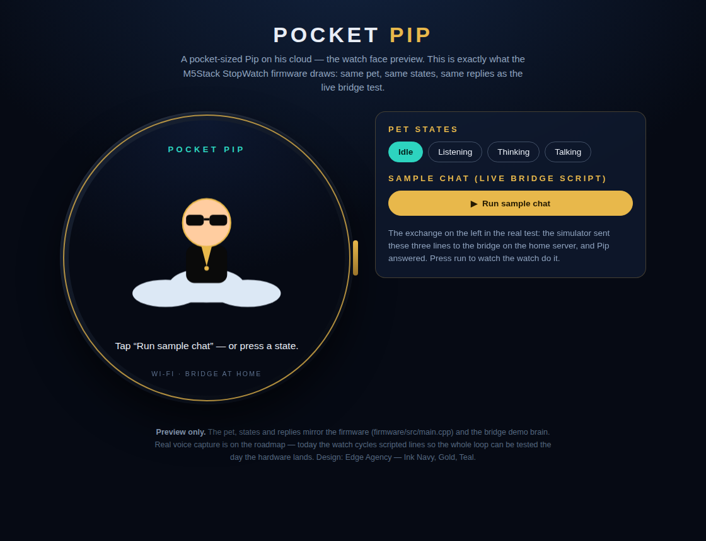

<picture>
  <source media="(prefers-color-scheme: dark)" srcset="assets/banner.svg">
  
</picture>

# Pocket Pip

**A pocket-sized AI companion who lives on a cloud, listens, and thinks back at the house.**
Local-first: the brain runs on a machine in your home. No cloud account, no subscription.


Inspired by Spencer Ryan's pocket-Jarvis watch build — rebuilt our way, with the receipts to show what actually works.

---

## The desk face — running today

The LESOWN P88 bar (1920 × 480) plugged into the home machine, served by the bridge itself,
mid-conversation with the live bridge (demo brain). The 🎙 button is push-to-talk voice.
Left: **Roboto's head** — floating, head only — with the agent strip underneath
(Pip · Scout · Builder · Writer, each with its live status). Right: the conversation,
with five switchable views up top — **Conversation · Agents · Activity · Results · Status** —
because the bar is an orchestration screen, not one chat box: the Agents view shows
who's doing what, Activity is the step feed, Results collects the finished work,
Status is the dashboard (state, brain, bridge, voice, last exchange).



## The watch face — the portable body, mirrored in the browser

Exactly what the M5Stack StopWatch firmware draws: same pet, same states, same replies.



## One Pip, every screen

The face is **Roboto** — the Robot Orchestra floating head
(`assets/roboto-head.png`, the canonical RO head image, byte-identical to the
one in the Robot Orchestra site assets), **head only, no body**, a little
bigger on the desk face than before. States are told apart by the head's
animation, the status line, and the **thinking bubble**: when a message lands,
the head shrinks *sideways* into the conversation — **anchored: its top edge
never moves, in any state, ever** — the bubble opens beside it and his
thoughts type out inside ("Reading that…", "Checking the clock at home
base…", "Putting the reply together…") while the step chips tick off
(Heard you → Thinking → Working → Talking → Done). A result card lands in
the chat, the head returns to full size, and he answers. The bridge records
the same five steps server-side (`GET /events`), with the working step
routed to an agent — **Pip · Scout · Builder · Writer** — so the bar's
Agents and Activity views show who's doing what. (The earlier Pip portrait
and its pose set stay in `assets/` as assets; they are not the face anymore.)

The desk face auto-fits any window. On a non-bar screen (aspect < 2:1) it
switches to a **compact layout with its own logical stage** (960 × 540, or
960 × 640 on 3:2 panels) — conversation view only, the head and bubble at
readable size — so the same face runs on Kevin's small ~3″ panel today and
the 1920 × 480 P88 bar later.

The retained portrait assets, cut per screen (kept in the repo; no longer the face):

| Variant | File | For |
|---|---|---|
| Round 480 × 480 | `assets/sizes/pip-round-watch-480.png` | Round displays |
| Round 240 × 240 | `assets/sizes/pip-round-watch-240.png` | Small round displays |
| Square 480 × 480 | `assets/sizes/pip-small-square-480.png` | Small square panels |
| Landscape 800 × 480 | `assets/sizes/pip-small-landscape-800x480.png` | Small wide panels |
| Bar 1920 × 480 | `assets/sizes/pip-bar-p88-1920x480.png` | The LESOWN P88 |


---

## Two bodies, one brain

| Body | What it is | Try it |
|---|---|---|
| 🖥️ **Desk face** | A LESOWN P88 bar LCD (8.8″, **1920 × 480**, mini-HDMI + USB power) plugged into a laptop or the home server, running a fullscreen kiosk page | Start the bridge, open `http://localhost:8765/display/`, F11 |
| ⌚ **Portable** | M5Stack StopWatch (C152) — ESP32-S3, 1.75″ round AMOLED, mic + speaker, 450 mAh | Firmware in [`firmware/`](firmware/); browser mirror in [`preview/`](preview/) |

Both talk to the same bridge; the bridge talks to the brain (a local Ollama
model, or a built-in demo brain so the loop works with zero setup). The bridge
also **serves both web faces itself**, so page and API share an origin — no
CORS friction.

```
  P88 desk face ──┐
                  ├──►  bridge (Python, :8765)  ──►  Ollama / demo brain
  StopWatch ──────┘     POST /chat · POST /voice        (on your home server)
                        GET /health · /events · /agents · faces at /display/ + /preview/
```

## 🎙️ Voice channel

Push-to-talk on the desk face: tap the mic, speak, and Pip answers out loud —
**listening** pose while you talk, **talking** pose while he replies. Two
honest paths, both local-first (the OpenAvatar bench pattern: ears + mouth
live on the host):

- **Zero-install (browser):** Chrome/Edge's Web Speech API does ears and
  mouth. Nothing to configure — open the desk face and tap the mic.
- **Bridge-local:** set two env vars and the bridge runs your own speech
  tools as external commands —
  `POCKETPIP_WHISPER_CMD` (ears; a CLI wrapping faster-whisper, transcript
  on stdout) and `POCKETPIP_PIPER_CMD` (mouth; Piper, text on stdin, WAV
  on stdout). `POST /voice` accepts `{"text": ...}` or raw
  `{"audio_base64": ...}` and returns the transcript, the reply, and the
  spoken reply as WAV.

If a needed tool isn't configured, `/voice` answers **503 and says exactly
what's missing** — no fake audio, ever. `GET /voice/status` shows the setup.

> The P88 bar has **no microphone and no speaker** — voice runs through the
> host computer's mic and speakers. On the StopWatch, the mic and speaker
> are on the watch itself; watch-side voice is the roadmap item that lands
> with the hardware.

## Quick start

```bash
# 1. Start the brain bridge (home machine — EDGESERVER or your PC)
python3 bridge/bridge.py            # http://localhost:8765

# 2. Light up a face — the bridge serves both pages itself
#    Desk:  http://localhost:8765/display/   (fullscreen on the P88)
#    Watch: http://localhost:8765/preview/   (the round face, in a browser)
#    Opening the files directly also works — demo mode if the bridge is down.

# 3. Talk to it like a watch would
python3 simulator/simulator.py      # scripted 3-message conversation
python3 simulator/simulator.py --interactive
```

Real brain instead of the demo: `OLLAMA_URL=http://localhost:11434 python3 bridge/bridge.py`.

Real voice instead of the browser's:

```bash
POCKETPIP_WHISPER_CMD='whisper {file} --model small' \
POCKETPIP_PIPER_CMD='piper --model /path/to/voice.onnx --output_file -' \
python3 bridge/bridge.py
```

Watch firmware: edit `firmware/src/config.h` (placeholders only in git), then
`pio run -e pocket-pip -t upload`. Full details in [`docs/SPEC.md`](docs/SPEC.md).

## Repo layout

| Path | What |
|---|---|
| `bridge/` | The brain bridge — stdlib-only Python server (`/chat`, `/voice`, `/health`, `/events`, `/agents`, token auth) that also serves the web faces |
| `simulator/` | CLI that pretends to be the watch, for hardware-free testing — prints the bridge's recorded step events per turn |
| `display/` | Desk face — 1920 × 480 kiosk page for the LESOWN P88: five views (Conversation / Agents / Activity / Results / Status), thinking bubble, push-to-talk voice (demo mode if the bridge is offline); compact layout for small panels |
| `preview/` | Round watch face in the browser — the StopWatch UI, mirrored, with the same step flow |
| `firmware/` | StopWatch firmware (PlatformIO, M5Unified) — Wi-Fi chat, BLE flagged off |
| `tests/` | Bridge test suite — `python3 tests/test_bridge.py` (stdlib unittest, boots the real bridge) |
| `assets/` | Banner, the Roboto head (`roboto-head.png` — the face), the retained Pip portrait (`pip-character.png` + web copy), per-state poses (`poses/`), per-screen size variants (`sizes/`), an animated clip (`pip-animated.mp4`), and screenshots of the actual surfaces, rendered headlessly from the live pages (`.svg` files wrap the rendered PNG pixels so GitHub displays them; the raw `.png` originals are alongside in the repo) |
| `docs/` | [`SPEC.md`](docs/SPEC.md) — architecture, transports, security · [`TEST-RUN.md`](docs/TEST-RUN.md) — test receipts |

## Status — honest version

**Proven (see [`docs/TEST-RUN.md`](docs/TEST-RUN.md) for receipts):**
- Bridge + simulator: full 3-message conversation loop, end to end.
- Firmware **compiles** for ESP32-S3 (PlatformIO, `firmware.bin` produced).
- Voice channel: `/voice` behaves honestly when unconfigured (503, says
  what's missing), and the full config plumbing — env vars → STT/TTS
  commands → transcript + reply + valid WAV audio — is proven end to end.
  The desk face's push-to-talk is wired to it, with the browser Web Speech
  path as the zero-install option.
- The bridge serves both faces itself; a headless browser load confirms
  the desk face reaches the bridge same-origin ("Live bridge").
- Both web faces are single self-contained files — the portrait and all
  poses are embedded in the page, no external assets, work offline. The
  screenshots above are renders of the real pages, taken during the
  test run.
- The pose set is wired and verified in a headless browser: all five
  states (idle, listening, thinking, typing, talking) swap to the right
  pose and animation on both faces, and the desk face's compact mode
  engages on a small 800 × 480 window (see TEST-RUN §9).
- **Production pass (TEST-RUN §10):** the bridge records **step events**
  per exchange (heard → thinking → working → talking → done, each with
  its agent, a thought line, and a measured duration) and serves them at
  `GET /events`; `GET /agents` serves the Pip / Scout / Builder / Writer
  roster. The desk face renders the work: anchored Roboto head, thinking
  bubble with typed thoughts, step chips, result cards, and the bar's
  five views. Compact mode is a real layout (its own 960-wide stage)
  that fills 800 × 480 and 480 × 320 panels. A stdlib test suite
  (`tests/test_bridge.py`, 11 tests) plus a 26-check headless browser
  run against the live bridge both pass; the simulator prints the
  recorded steps per turn.

**Not yet:**
- The voice plumbing was proven with **stub speech tools** — real
  faster-whisper and Piper are not installed in the test VM, and the VM
  has no microphone, so no live human-voice run has happened yet. The
  config is two env vars on the host (above).
- Firmware has **not** run on real StopWatch hardware (the watch isn't
  here yet) — compile-proven only. Watch-side voice lands with it.
- BLE transport is designed and feature-flagged **off**, not implemented.
- Ollama brain path is code-reviewed but untested (no Ollama in the VM);
  the demo brain is what every receipt above ran on.
- There is **no Tailscale client on ESP32** — away-from-home access
  terminates the tunnel on the bridge host (Tailscale Serve/Funnel).
  The spec says so plainly.

## Design

Edge Agency system — Ink Navy `#060A14`, Gold `#E8B84B`, Teal `#2DD4BF`, Space Grotesk / Inter.
The face is Roboto — the Robot Orchestra floating head, one canonical image
(`assets/roboto-head.png`, head only) embedded in both web faces; Roboto's design
itself is unchanged from Robot Orchestra. The earlier Pip look (glossy white head,
sunglasses, black suit, gold tie, laptop with the gold P, sitting on his cloud) is
one canonical portrait — `assets/pip-character.png` — kept in the repo with its
per-state poses in `assets/poses/`, and still carried in the banner.
The firmware draws its own small rendition of the character.
